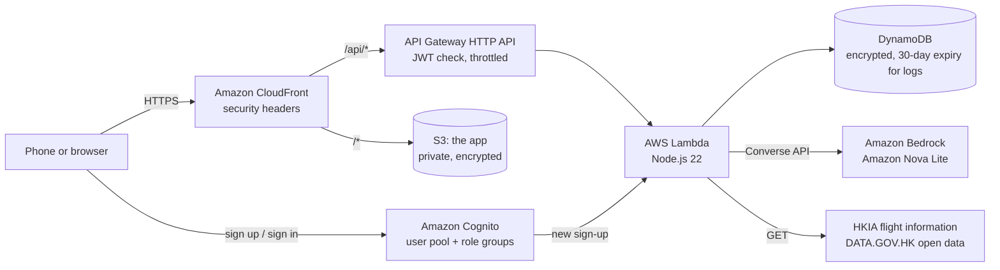

# Smooth Journey

**Cathay Hackathon 2026 · Team E394 – Nevada** (Chris, Ruthvik, Ingram, Abi)

Smooth Journey is one optional layer in an airline app that plans, tracks and confirms assistance for passengers with reduced mobility, sensory or hidden disabilities, older travellers and their carers, from booking to arrival. Passenger, carer, ground staff, cabin crew and supervisors each have their own app and share one live plan. Every handover is confirmed by staff, so the journey can be followed even when the passenger's phone is off.

> **Student concept prototype.** Not a Cathay Pacific product and not endorsed by Cathay Pacific. Flights, bookings and policy text are fictional. Please don't enter real personal or health information: the demo staff login is public, so treat anything you type as public.

**Live app:** `https://<your-cloudfront-domain>` · **Three-phone demo:** `/demo.html` (see `SUBMISSION.md`)

---

## The app

An installable web app: open the link on a phone and tap **Add to Home Screen** (iPhone: Share → Add to Home Screen). It gets its own icon and opens full screen.

| Who | Signs in as | What they can do |
|---|---|---|
| **Passenger** | Self sign-up (email + verification code) | Access Passport (AI turns plain words into IATA service codes), book CX 255 with the 48-hour rule, approve the AI-drafted crew brief word for word, live journey with "I'm here, where's my help?", in-flight coach with discreet help, report a problem, Ask (AI concierge with sources), Privacy (sharing switches, invite a carer, access log, export, delete account) |
| **Carer** | Self sign-up | Enter a one-time code from the passenger, then follow their journey live. Sees where they are, never their codes or notes. Sharing can be paused or stopped by the passenger at any time |
| **Ground staff** | Invite-only | Check new Access Passports (remove wrong codes, then confirm). Pick their post (check-in, security, gate, Heathrow arrival) and see only passengers at that post. Confirm handovers, answer help requests |
| **Cabin crew** | Invite-only | Pre-flight briefing with each passenger's approved brief (or safety information only, if they chose not to share), discreet help requests, hand over to the arrival team |
| **Supervisor** | Invite-only | Live handovers, overdue and help alerts, Passports waiting, delay re-plan with human approval, **real HKIA departure data**, reset the demo |

Every action updates the other phones within about four seconds.

## Architecture



- `frontend/index.html`: the app (sign-up, sign-in, five role apps). `frontend/demo.html`: the three-phone demo. No build step, no trackers, no cookies.
- `backend/`: one Lambda. `app.mjs` decides what each role may see and do, `ai.mjs` holds the AI jobs and privacy filters, `db.mjs` the data layer, `index.mjs` the routes and the sign-up trigger.
- `template.yaml`: everything as code (AWS SAM). One command deploys it.

## AI, with guardrails

| AI job | Guardrails |
|---|---|
| Access Passport: plain words (English or Chinese) → IATA SSR codes, medical-clearance and evacuation flags | Personal details and condition names removed in the browser **and again on the server**. Only whitelisted codes accepted. A staff member confirms before use |
| Crew brief | Written only from checked needs. The evacuation line is added by code, never left to the AI. The passenger edits and approves the exact words |
| Ask | Answers only from policy excerpts, with the source and a confidence score. Safety, medical and battery questions never reach the AI. Below 80% confidence → a person |

The prompts live on the server, so the API can't be used as a general chatbot. If the AI is off or unavailable, built-in rules take over and everything still works.

## Privacy and security

- **Explicit consent** before any processing. Accessibility needs are treated as sensitive health information.
- **Needs, not diagnoses.** Condition names are stripped and never stored (only a flag that some were removed). Original words are deleted once staff confirm the codes.
- **Need-to-know, enforced on the server.** Staff see only passengers at their post; carers see progress, not details; crew see the approved brief or safety information only; supervisors see status, not service details. Nobody can sign up as staff: new accounts are put in the passenger or carer group by a server-side trigger.
- **Passenger control:** five sharing switches, pause or remove carers, a log of every staff view and action, "see all my data", and delete data and account.
- **AI privacy:** Amazon Bedrock doesn't store or log prompts and completions, and doesn't use them for training. Our Lambda never logs request content, only error types, and keeps logs 7 days.
- **Storage:** DynamoDB encrypted at rest with point-in-time recovery; history items expire after 30 days. S3 is private behind CloudFront Origin Access Control.
- **Transport and browser:** HTTPS only, HSTS, a strict Content-Security-Policy, `X-Frame-Options: DENY`, `nosniff`, Permissions-Policy.
- **API:** every signed-in route needs a valid Cognito token, checked by API Gateway before our code runs. Throttled, 12 KB body limit. Least-privilege IAM.

---

## Deploy it (about 30 minutes, nothing to install)

You need an AWS account where you can create IAM roles, Lambda, API Gateway, DynamoDB, Cognito, S3 and CloudFront. Everything runs in **AWS CloudShell**, a terminal in your browser.

### 1. Pick a region and switch on Amazon Nova in Amazon Bedrock

1. Sign in to the AWS console. In the top-right region menu, pick a region where Amazon Bedrock offers **Amazon Nova Lite**, such as **Asia Pacific (Tokyo)** or **Asia Pacific (Singapore)**. Use the same region for every step.
2. Open **Amazon Bedrock → Model catalog**, filter by provider **Amazon**, and open **Nova Lite**. (If your console has a **Model access** page, request access to Nova Lite there first.)
3. Click **Open in playground** and send "hello" to check it answers.
4. Copy the model's **inference profile ID** if one is shown (for example one starting `apac.`), otherwise the **model ID**.

Any text model on Bedrock works the same way: the code uses Bedrock's model-neutral Converse API, so switching models is just a different ID.

### 2. Get the code into CloudShell

Click the **CloudShell** icon (`>_`) in the console's top bar:

```bash
git clone https://github.com/<your-github-username>/smooth-journey.git
cd smooth-journey
chmod +x deploy.sh setup-demo.sh
```

### 3. Deploy, then create the demo accounts

```bash
./deploy.sh <paste-model-or-inference-profile-id>   # 5-10 minutes the first time
./setup-demo.sh                                       # 1 minute: demo accounts + Mrs Chan's trip
```

(`./deploy.sh` with no ID deploys without AI, using the built-in rules.)

The script prints your link. Open it on your phone and tap **Add to Home Screen**.

### Demo accounts

Password: `SmoothDemo2026` (or the one you passed to `setup-demo.sh`). They also appear as one-tap buttons on the welcome screen.

| Role | Email |
|---|---|
| Passenger (Mrs Chan, booked on CX 255) | `mrs.chan@example.com` |
| Carer (Mei, already following Mrs Chan) | `mei@example.com` |
| Ground staff (Alex Wong) | `staff@example.com` |
| Cabin crew (Daniel Yip) | `crew@example.com` |
| Supervisor (Priya Shah) | `supervisor@example.com` |

Try it with three phones: passenger, carer and staff. Passenger taps **Trip → Start travel day**; staff confirm each step at their post; the carer's phone updates by itself. The supervisor can **Reset the demo trip** at any time.

To add a real staff member: `aws cognito-idp admin-create-user` and `admin-add-user-to-group --group-name staff` (see `setup-demo.sh` for the exact commands).

### 4. Update after a change

```bash
cd ~/smooth-journey && git pull && ./deploy.sh <same-model-id>
```

### Costs and safety net

For a hackathon demo, S3, CloudFront, Lambda, API Gateway, DynamoDB (on-demand) and Cognito cost very little or fall within free tiers. Bedrock charges per token, and each AI call here is small. **Set a budget alert first:** Billing and Cost Management → Budgets → monthly cost budget (e.g. US$10) with an email alert.

### Remove everything afterwards

```bash
BUCKET=$(aws cloudformation describe-stacks --stack-name smooth-journey --query "Stacks[0].Outputs[?OutputKey=='BucketName'].OutputValue" --output text)
aws s3 rm "s3://$BUCKET" --recursive
sam delete --stack-name smooth-journey --no-prompts
```

### Troubleshooting

| Symptom | Fix |
|---|---|
| AccessDenied page right after the first deploy | CloudFront is still spreading; wait a few minutes |
| Welcome screen says "Not set up yet" | Run `./deploy.sh` again; it writes the app's sign-in settings |
| No demo buttons on the welcome screen | Run `./setup-demo.sh` |
| Verification email doesn't arrive | Check spam. Cognito's built-in email has a small daily limit (about 50 a day); use the demo accounts for judging |
| AI pill or answers say rules/standard | `curl …/api/health`. If `"ai":false`, redeploy with the model ID; if `true`, check the Lambda's log group in CloudWatch |
| Logs show `AccessDeniedException` from Bedrock | Do step 1.3 in the **same region** |
| Logs show `ValidationException` about on-demand throughput | Use the **inference profile ID** |
| Deploy fails with AccessDenied on CloudFront, Cognito or IAM | The account is restricted (common for classroom accounts); ask the organisers' tech help desk |

## Tests

```bash
npm install
npm test                              # backend: all five roles, permissions, consent, redaction, AI guardrails, deletion
node tests/e2e/server.mjs &           # end to end: real backend, in-memory database, fake model and sign-in service
python3 tests/e2e/run.py tests/e2e    # five signed-in browsers walk a whole journey (needs Python Playwright)
```

## Repository layout

```
frontend/index.html      the app: sign-in and the five role apps
frontend/demo.html       the three-phone demo for presentations
frontend/manifest.webmanifest, sw.js, icons   installable app files
backend/index.mjs        routes, sign-up trigger, HKIA open data
backend/app.mjs          what each role may see and do (need-to-know rules)
backend/ai.mjs           Bedrock calls, privacy filters, rule-based fallback
backend/db.mjs           DynamoDB data layer
template.yaml            AWS SAM: CloudFront, S3, Cognito, API Gateway, Lambda, DynamoDB, IAM
deploy.sh, setup-demo.sh one-command deploy and demo setup for CloudShell
tests/                   unit and end-to-end tests
SUBMISSION.md            links for the hackathon submission
```

## Data sources

- Hong Kong International Airport flight information, Airport Authority Hong Kong, via [DATA.GOV.HK](https://data.gov.hk/en-data/dataset/aahk-team1-flight-info): previous-day departures fetched live by the backend.
- IATA special service request (SSR) codes for passenger assistance.
- Policy text in the app is written for this prototype and is not Cathay Pacific policy.
